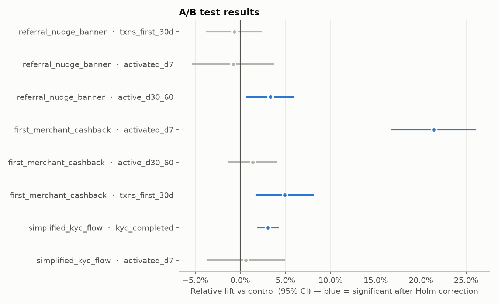

# A/B testing report

Three growth experiments ran on consecutive signup cohorts with 50/50 random assignment.
Each one declares its primary metric, secondary metrics and guardrails up front. Tests are two-sided at
alpha = 0.05 with Holm correction across each experiment's metrics, and users only enter a metric once
they have enough history for it to be observable (no right-censoring bias).

## 1. Design (before launch)

Baselines come from the three signup cohorts before each test; sample sizes target 80% power.

| experiment | primary_metric | baseline | baseline_sd | mde | required_n_per_arm |
|---|---|---|---|---|---|
| referral_nudge_banner | txns_first_30d | 3.183 | 3.552 | +0.25 txns | 3,170 |
| first_merchant_cashback | activated_d7 | 0.273 | 0.445 | +3 pts | 3,575 |
| simplified_kyc_flow | kyc_completed | 0.830 | 0.375 | +2 pts | 5,260 |

## 2. Results

### referral_nudge_banner

*Hypothesis:* A home-screen banner nudging users to refer friends increases early usage.

- Sample: 10,228 control / 10,338 treatment; SRM p = 0.443
  (OK)
- Primary metric `txns_first_30d`: 3.267 -> 3.245
  (-0.02 txns, 95% CI -0.12 to +0.08;
  relative -0.7%; Holm-adjusted p = 1.0000)
- Power to detect the planned MDE: 100%
- **Decision: DON'T SHIP - well-powered test found no meaningful effect**

### first_merchant_cashback

*Hypothesis:* Cashback on the first merchant (P2M) payment increases 7-day activation.

- Sample: 9,965 control / 10,021 treatment; SRM p = 0.692
  (OK)
- Primary metric `activated_d7`: 0.275 -> 0.334
  (+5.89 pts, 95% CI +4.62 to +7.17;
  relative +21.4%; Holm-adjusted p = 0.0000)
- Power to detect the planned MDE: 100%
- **Decision: SHIP**

### simplified_kyc_flow

*Hypothesis:* A shorter KYC flow increases KYC completion.

- Sample: 11,238 control / 11,299 treatment; SRM p = 0.684
  (OK)
- Primary metric `kyc_completed`: 0.832 -> 0.858
  (+2.55 pts, 95% CI +1.61 to +3.49;
  relative +3.1%; Holm-adjusted p = 0.0000)
- Power to detect the planned MDE: 98%
- **Decision: SHIP**

Full results (all metrics):

| experiment | metric | role | n_control | n_treatment | control | treatment | diff | ci_low | ci_high | rel_lift | p_value | p_holm | significant |
|---|---|---|---|---|---|---|---|---|---|---|---|---|---|
| referral_nudge_banner | txns_first_30d | primary | 10,228 | 10,338 | 3.2671 | 3.2449 | -0.0222 | -0.1212 | 0.0768 | -0.0068 | 0.6605 | 1.0000 | no |
| referral_nudge_banner | activated_d7 | secondary | 10,228 | 10,338 | 0.2741 | 0.2719 | -0.0021 | -0.0143 | 0.0100 | -0.0078 | 0.7303 | 1.0000 | no |
| referral_nudge_banner | active_d30_60 | guardrail | 10,228 | 10,338 | 0.5259 | 0.5433 | 0.0174 | 0.0038 | 0.0311 | 0.0331 | 0.0122 | 0.0367 | yes |
| first_merchant_cashback | activated_d7 | primary | 9,965 | 10,021 | 0.2752 | 0.3341 | 0.0589 | 0.0462 | 0.0717 | 0.2142 | 0.0000 | 0.0000 | yes |
| first_merchant_cashback | active_d30_60 | secondary | 9,965 | 10,021 | 0.5315 | 0.5387 | 0.0072 | -0.0066 | 0.0210 | 0.0136 | 0.3070 | 0.3070 | no |
| first_merchant_cashback | txns_first_30d | secondary | 9,965 | 10,021 | 3.2896 | 3.4516 | 0.1619 | 0.0580 | 0.2659 | 0.0492 | 0.0023 | 0.0045 | yes |
| simplified_kyc_flow | kyc_completed | primary | 11,238 | 11,299 | 0.8324 | 0.8580 | 0.0255 | 0.0161 | 0.0349 | 0.0306 | 0.0000 | 0.0000 | yes |
| simplified_kyc_flow | activated_d7 | secondary | 10,781 | 10,839 | 0.2802 | 0.2819 | 0.0017 | -0.0103 | 0.0137 | 0.0062 | 0.7773 | 0.7773 | no |

## 3. Heterogeneity: cashback effect on activation by channel (exploratory)

| channel | n | control | treatment | diff | ci_low | ci_high | p_value |
|---|---|---|---|---|---|---|---|
| organic | 9,910 | 0.2676 | 0.3301 | 0.0625 | 0.0446 | 0.0805 | 0.0000 |
| paid | 5,007 | 0.2423 | 0.2853 | 0.0430 | 0.0186 | 0.0674 | 0.0006 |
| referral | 5,069 | 0.3224 | 0.3901 | 0.0677 | 0.0414 | 0.0940 | 0.0000 |

Segment cuts are exploratory: they are not powered individually and are only used to generate hypotheses.

## 4. Validation against the planted ground truth

Because the platform is simulated, we know the true effects. A correct analysis should bracket them:

| effect | planted_diff | estimated_diff | ci_low | ci_high | truth_in_ci |
|---|---|---|---|---|---|
| cashback -> activation | 0.0628 | 0.0589 | 0.0462 | 0.0717 | yes |
| KYC flow -> KYC completion | 0.0254 | 0.0255 | 0.0161 | 0.0349 | yes |
| referral banner -> txns (true null) | 0.0000 | -0.0222 | -0.1212 | 0.0768 | yes |

- `referral_nudge_banner` / `active_d30_60` reached significance (Holm p = 0.037) although the primary metric showed nothing and the planted effect is zero. This is the kind of false positive the primary-metric decision rule protects against.

## Practical notes

- **Statistical vs practical significance.** The KYC flow lift is real but small; weigh it against
  engineering and compliance cost. The cashback lift should be weighed against its cost per activated user
  using the CLV estimates in the growth report.
- **Novelty effects.** A short window can overstate the effect of a banner; the retention guardrail covers
  this partly.
- **Peeking.** Results are read once at the planned sample size; continuous monitoring would need a
  sequential test (e.g. mSPRT or alpha spending).
