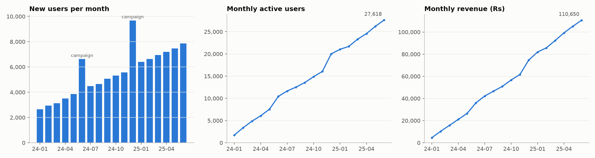
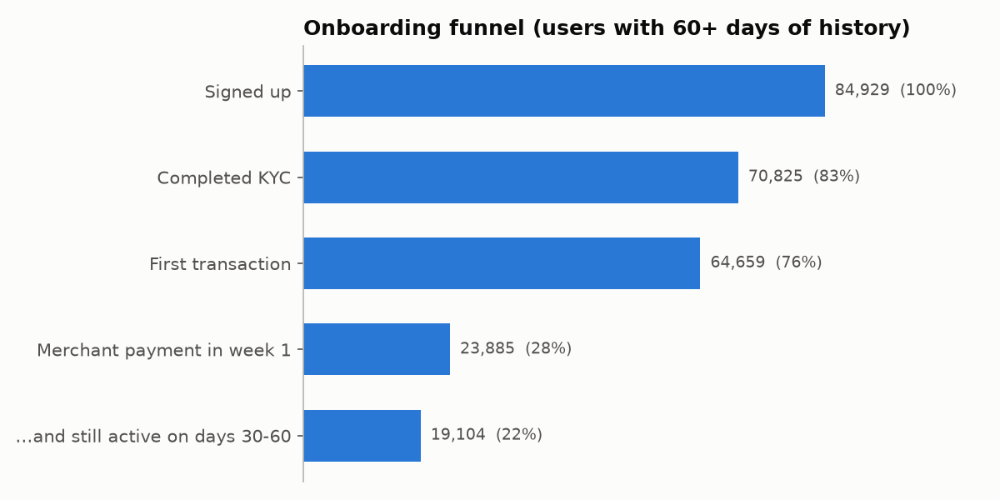
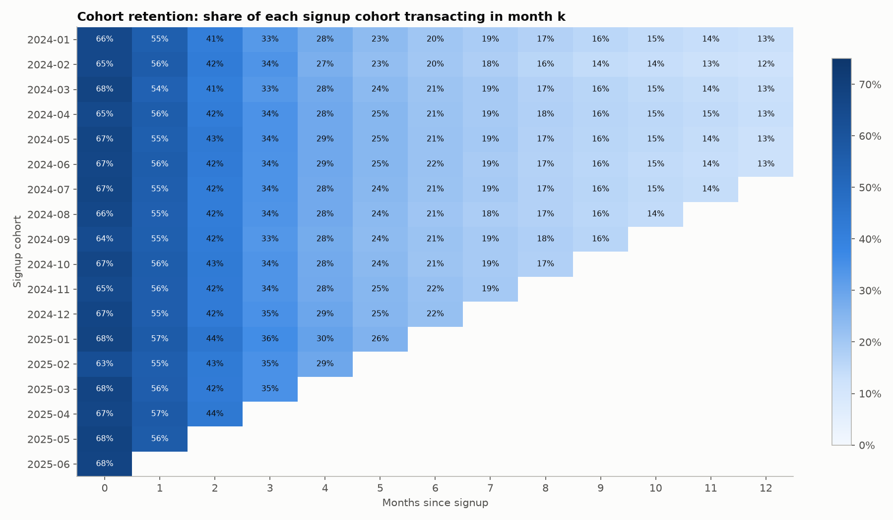
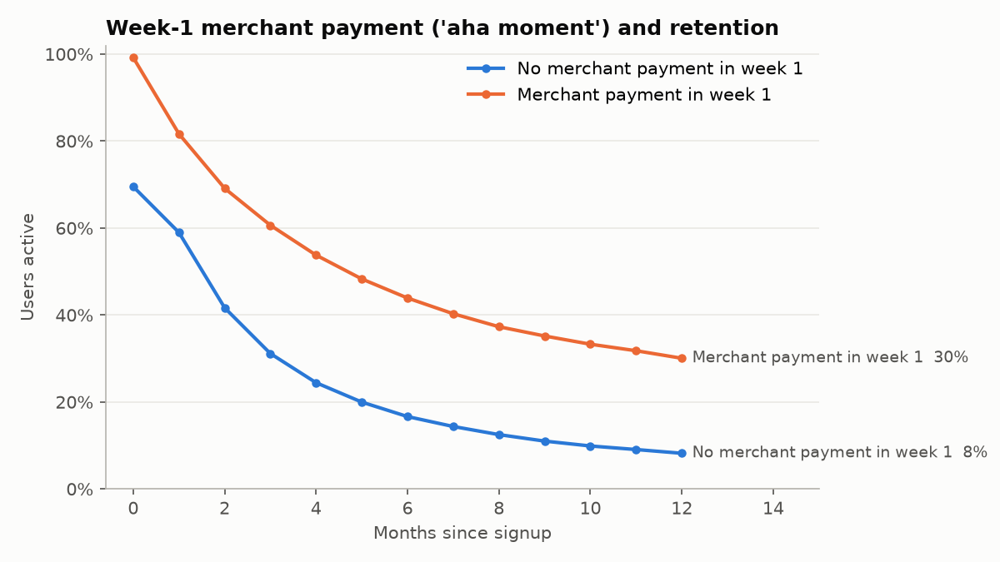
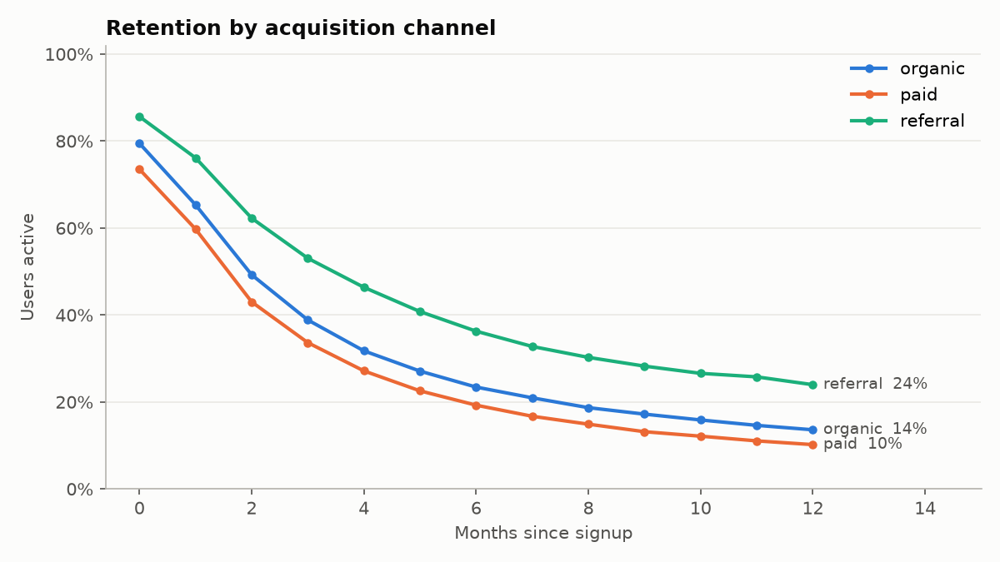
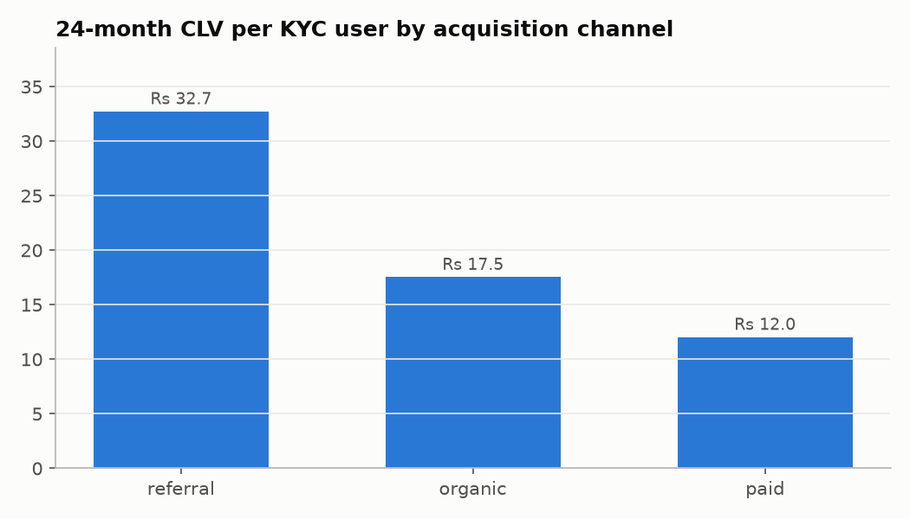
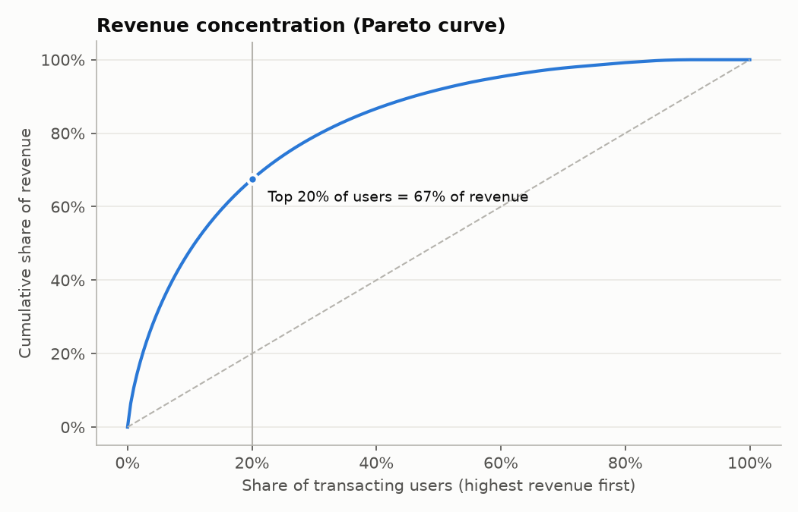

# Growth analytics report

*Simulated UPI platform: 100,000 users, 1,309,545 successful
transactions, 2024-01 to 2025-06. All figures come from the SQL marts in
`data/simulated/upi.db`.*

## Key findings

1. **The week-1 merchant payment is the activation moment.** Users who pay a merchant within 7 days of
   signup are 43.9% active at month 6 vs
   16.6% for everyone else. Controlling for channel, city tier,
   device and age, activation multiplies the odds of day 30-60 retention by
   **3.0x** (95% CI 2.9-3.2). This is an
   association; the cashback experiment below tests the causal lever.
2. **Referral is the most valuable channel.** 24-month CLV per KYC user: referral
   Rs 32.7 vs paid Rs 12.0
   (2.7x). Paid users activate and retain worst, so paid CAC must sit
   well below Rs 12 to break even.
3. **Revenue is concentrated.** The top 20% of transacting users generate 67.4% of revenue;
   "Champions" are 23.7% of transacting users but
   61.1% of revenue.
4. **Biggest funnel leak is activation.** 83.4% complete KYC but only
   28.1% make a merchant payment in week 1.
5. **Growth is healthy but decelerating.** MAU grew 14.0% per month (compound) to
   27,618; DAU/MAU stickiness is 15.2%.

## Funnel

| step | users | pct_of_signups | step_conversion |
|---|---|---|---|
| Signed up | 84,929 | 100.0% |  |
| Completed KYC | 70,825 | 83.4% | 83.4% |
| First transaction | 64,659 | 76.1% | 91.3% |
| Merchant payment in week 1 | 23,885 | 28.1% | 36.9% |
| ...and still active on days 30-60 | 19,104 | 22.5% | 80.0% |

Conversion by channel (share of signups reaching each step):

| channel | Completed KYC | First transaction | Merchant payment in week 1 | ...and still active on days 30-60 |
|---|---|---|---|---|
| organic | 83.4% | 76.1% | 27.9% | 21.9% |
| paid | 83.5% | 72.9% | 24.0% | 18.1% |
| referral | 83.3% | 79.4% | 32.8% | 28.1% |

## Retention

## Customer lifetime value

CLV = sum over 24 months of (retention in month k) x (revenue per active month) x 1%/month discount.
Months 13-24 are projected by extending the observed decay of months 9-12.

| segment | m1_retention | m6_retention | m12_retention | revenue_per_active_month | clv_24m | clv_24m_per_signup |
|---|---|---|---|---|---|---|
| referral | 0.761 | 0.363 | 0.240 | 4.656 | 32.734 | 27.287 |
| organic | 0.653 | 0.234 | 0.136 | 3.645 | 17.543 | 14.641 |
| paid | 0.598 | 0.193 | 0.102 | 3.006 | 12.040 | 10.052 |

First-6-month value by city tier:

| segment | users | kyc_rate | activation_rate | d30_60_retention | revenue_6m_per_user | revenue_6m_total |
|---|---|---|---|---|---|---|
| 1 | 22,383 | 0.848 | 0.309 | 0.577 | 11.550 | 258,466.000 |
| 2 | 25,598 | 0.851 | 0.276 | 0.537 | 8.930 | 228,493.000 |
| 3 | 15,903 | 0.789 | 0.232 | 0.464 | 6.580 | 104,592.000 |

## RFM segmentation

| rfm_segment | users | avg_recency_days | avg_txns | avg_revenue | share_of_users | share_of_revenue |
|---|---|---|---|---|---|---|
| Champions | 17,883 | 6.66 | 44.53 | 34.91 | 0.24 | 0.61 |
| At risk | 13,651 | 277.12 | 16.67 | 12.91 | 0.18 | 0.17 |
| Loyal | 13,768 | 58.01 | 15.20 | 11.82 | 0.18 | 0.16 |
| Needs attention | 6,753 | 88.55 | 2.58 | 1.96 | 0.09 | 0.01 |
| Hibernating | 16,550 | 303.40 | 2.55 | 1.95 | 0.22 | 0.03 |
| New / promising | 6,898 | 10.30 | 2.44 | 1.87 | 0.09 | 0.01 |

## Activation impact: logistic regression (adjusted odds ratios)

n = 70,825 KYC users with 60+ days of history; pseudo R² = 0.060.

| index | odds_ratio | ci_low | ci_high | p_value |
|---|---|---|---|---|
| C(channel)[T.paid] | 0.808 | 0.778 | 0.839 | 0.000 |
| C(channel)[T.referral] | 1.703 | 1.635 | 1.775 | 0.000 |
| C(city_tier)[T.2] | 0.844 | 0.813 | 0.875 | 0.000 |
| C(city_tier)[T.3] | 0.718 | 0.689 | 0.749 | 0.000 |
| C(device)[T.ios] | 1.017 | 0.972 | 1.063 | 0.468 |
| C(age_group)[T.25-34] | 0.985 | 0.947 | 1.023 | 0.428 |
| C(age_group)[T.35-44] | 1.016 | 0.970 | 1.064 | 0.496 |
| C(age_group)[T.45+] | 0.991 | 0.935 | 1.051 | 0.769 |
| activated_d7 | 3.039 | 2.929 | 3.153 | 0.000 |

## Recommendations

- Make the **first merchant payment** the north-star onboarding goal: in-app QR prompts, merchant discovery,
  and the first-payment cashback (validated in the A/B report).
- **Shift acquisition budget from paid to referral**; reward referrers on the referee's *activation*, not signup.
- Protect **Champions** (priority support, limits) and run win-back flows for **At risk** users before they lapse.
- Investigate **tier-3 KYC drop-off** (lower KYC and activation rates): vernacular KYC and assisted onboarding.
